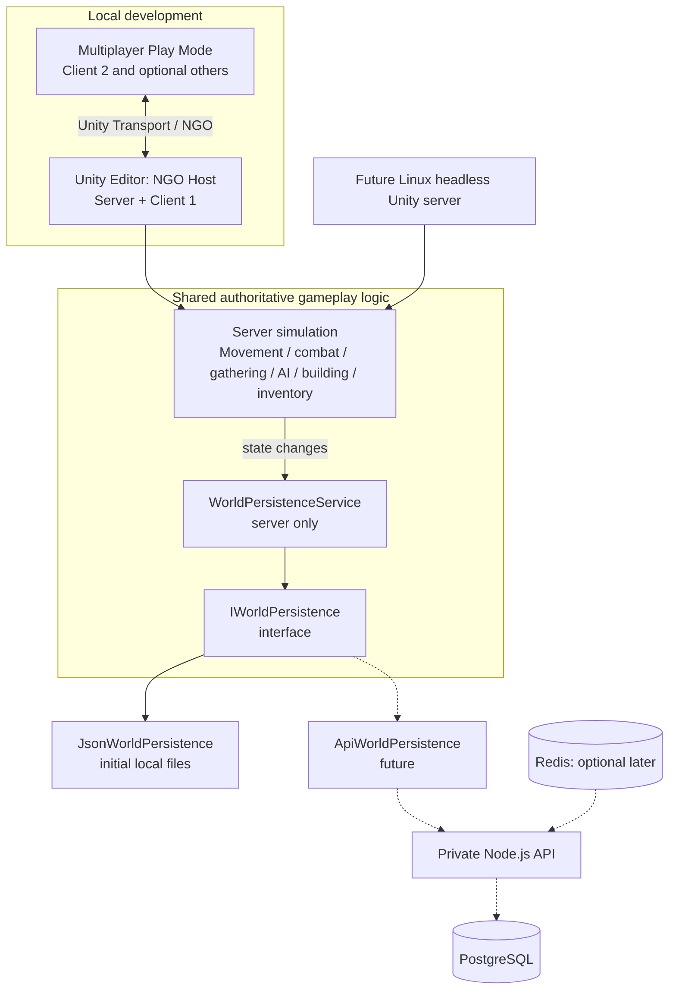

# Voyageur — Editor-First Hosted-World Multiplayer Architecture

> Implementation specification for Cursor. Use this document as the target architecture and migration plan. **Do not implement every phase at once.** Inspect the existing project, propose a narrowly scoped set of changes, and complete/test each phase before moving on.

## 1. Goals and constraints

Voyageur is a Unity 6.x survival/crafting game being migrated from single-player to a Rust-style **persistent, dedicated, server-authoritative world** for approximately **12–24 players per world**.

The highest priority **right now** is a fast development loop:

- Edit code/assets in Cursor or Unity → press **Play in the Unity Editor** → debug with normal Unity tools.
- The primary Editor should normally run **Host** (`StartHost()`): authoritative server + local player client in one process.
- Unity **Multiplayer Play Mode** should allow additional virtual player instances to join as **Clients** (`StartClient()`), ideally without rebuilding the game.
- A standalone/headless server is **not required for everyday iteration**.
- The exact same authoritative gameplay rules must also run in **Server-only** (`StartServer()`) mode later, including on a Linux Unity Dedicated Server build hosted on AWS.
- Add persistent world/player saves early, but use **local JSON files** for development. Do **not** require PostgreSQL, Redis, Node.js, AWS, or container infrastructure now.
- Protect existing single-player gameplay as much as practical while progressively migrating it. Do not perform a risky all-at-once rewrite.

### Explicit non-goals for the initial milestones

- Deploying to AWS or building CI/CD pipelines.
- Creating a PostgreSQL schema, Node persistence API, or Redis deployment.
- Matchmaking, join codes, hosted account system, cross-world transfers, or sharding.
- Full anti-cheat, complex interest management, or scale claims without profiling.

## 2. Architectural overview



**Core rule:** Unity server memory owns the **live simulation**. The persistence layer owns **recoverable state**. NGO/Unity Transport synchronizes gameplay state to clients. Neither PostgreSQL nor Redis should become the per-tick multiplayer simulation engine.

## 3. Networking architecture

Use:

- **Netcode for GameObjects (NGO)** and **Unity Transport**.
- **Unity Multiplayer Play Mode** for local multi-instance testing.
- Unity **Linux Dedicated Server build profile/build support** for eventual headless deployment. Verify actual project Unity version and installed packages before making package changes; do not assume a separate Dedicated Server *package* is required.

### Three runtime modes

| Mode | NGO startup | Purpose |
|---|---|---|
| `Host` | `NetworkManager.Singleton.StartHost()` | Default single-Editor iteration; authoritative simulation and local client |
| `Client` | `NetworkManager.Singleton.StartClient()` | Additional multiplayer players; connects to host/server |
| `Server` | `NetworkManager.Singleton.StartServer()` | Dedicated server-only testing and eventual deployment |

Implement **one central bootstrap/configuration path** supporting `Host`, `Client`, and `Server`, plus configurable address/UDP port (initially localhost and e.g. port 7777). Avoid spawning duplicate `NetworkManager` instances or unintentionally auto-starting a server in each virtual player.

For Multiplayer Play Mode, inspect the installed version and available role configuration mechanisms. Ensure the **primary Editor starts Host and secondary players start Client**. Validate the actual behavior; don't assume all package versions launch in the same way.

### Authority boundaries

- The server owns player health, inventory, combat outcomes, resource/tree damage, item transfers, crafting validity, building placement, containers, loot, enemy AI, and persistent world mutations.
- Clients send **intent** (e.g. `RequestHarvest`, `RequestCraft`, `RequestPlace`, `Fire`) through NGO RPCs; the server validates and applies changes. Never trust client messages such as “I now have 99 wood.”
- Owner-local systems (input, camera, HUD, audio listener) run only for the local owning client. Dedicated server must not depend on these systems being present.
- Do not use process-global static player state for per-player inventory/health/progression. Migrate existing single-player globals progressively to per-player authoritative state with clear ownership.
- Keep shared, read-only definitions (item catalogs, recipes, etc.) separate from runtime player/world state.
- Network object runtime IDs are **not durable save IDs**. Create stable persistent IDs for saveable buildings, containers, resources, and other world objects.
- Prefer one common gameplay code path. Avoid `if (isHost)` shortcuts that make Host behave differently from a dedicated server. Use server/owner/client checks appropriately.

### Areas to inspect and migrate

Existing project references from initial review; confirm actual files/paths:

- `Assets/Scripts/Globals/Events.cs`, `GameState.cs`, and `PlayerItems`.
- `Assets/Scripts/PlayerUI/PlayerInventory.cs`, crafting system and hotbar.
- `Assets/Scripts/Gathering/TreeHarvestController.cs`.
- `Assets/Building/Scripts/PlayerBuildingObjectController.cs`.
- Enemy AI (`Enemy.cs`), world containers, loot, and player movement controller.

**Unity Terrain trees:** avoid synchronizing full terrain data each tick. Represent harvestable state using stable tree/resource identifiers and authoritative deltas, or convert appropriate harvestables into networked prefabs. Decide based on the project's existing terrain implementation.

## 4. Fast Editor-first workflow and debugging

### Daily workflow

1. **Single player / rapid debugging:** press Play in the main Editor; it starts Host. Set breakpoints and use the Inspector as usual.
2. **Two-player behavior:** use Multiplayer Play Mode to launch an additional client. Both clients should see the same server-owned world state.
3. **Server-only sanity checks:** occasionally run in Server mode with clients connecting; verify the simulation has no camera, input, or other client dependency.
4. **Headless verification later:** build and launch a standalone Linux Dedicated Server locally or on EC2. This should be largely a runtime/build/deployment change, not a second implementation of gameplay rules.

### Logging and debug tooling

- Include runtime role (`Host`, `Client`, `Server`), client ID, and ownership information in relevant networking logs.
- Provide a minimal debug UI or configuration for mode/address/port, with sensible Editor defaults.
- Provide tests for: join/leave, two-player spawn, movement visibility, inventory isolation, server validation, reconnect behavior when added.
- Be alert for bugs masked by Host mode (host-only state, RPC timing, ownership, and transport assumptions). Regularly exercise a **remote client**, not just Host alone.
- Multiplayer Play Mode virtual players have their own context; account for its exact debugging/logging capabilities in the installed version instead of promising identical main-Editor breakpoint behavior in every instance.

## 5. Persistence abstraction

### Principle

**Gameplay must not know where data is stored.** Use a server-only persistence service with an interchangeable storage adapter.

```text
Gameplay / WorldState
       |
       v
WorldPersistenceService  (server only)
       |
       v
IWorldPersistence
       |-- JsonWorldPersistence   (initial development)
       |-- InMemoryWorldPersistence (optional automated tests)
       `-- ApiWorldPersistence    (future Node/Postgres)
```

### Proposed interfaces (adapt to real codebase)

Use simple versioned DTOs without `GameObject`, `MonoBehaviour`, `NetworkObject`, or other runtime Unity object references. The interface below is conceptual and should be refined to avoid expensive full-world saves for every change.

```csharp
public interface IWorldPersistence
{
    Task<WorldSaveData> LoadWorldAsync(string worldId, CancellationToken ct = default);
    Task SaveWorldSnapshotAsync(string worldId, WorldSaveData snapshot, CancellationToken ct = default);

    Task<PlayerSaveData> LoadPlayerAsync(string worldId, string playerId, CancellationToken ct = default);
    Task SavePlayerAsync(string worldId, string playerId, PlayerSaveData player, CancellationToken ct = default);

    // Future: write batches of durable changes atomically.
    // Task CommitChangesAsync(string worldId, IReadOnlyList<WorldChange> changes, CancellationToken ct = default);
}
```

Potential DTOs:

- `WorldSaveData`: schema version, `worldId`, world seed/settings, objects/resources/world mutations.
- `PlayerSaveData`: stable player identity, last position, health, inventory, progression.
- `BuildingSaveData`: stable `persistentId`, stable prefab/definition ID, transform, health and custom state.
- `ContainerSaveData`: stable ID, contents and relevant state.

**Identity:** client connection IDs and NGO `NetworkObjectId` can change across runs. Persist stable world/player/object IDs separately.

### Initial implementation: JSON

- Implement `JsonWorldPersistence` using files beneath `Application.persistentDataPath` (separate world IDs and player IDs; sanitize IDs for paths).
- Save on server only. Clients never directly write authoritative state.
- Keep Unity API object capture/apply on the **Unity main thread**. Serialize plain DTO snapshots; move blocking filesystem I/O off the main thread when appropriate. Do not access Unity scene objects from arbitrary background threads.
- Include schema versioning, reasonable error handling, and load/default-world handling.
- Use safe file replacement (temporary file + replace/rename with appropriate platform semantics) rather than blindly overwriting a save; consider a previous-good backup.
- Save/load in a predictable lifecycle: initialize world from storage before accepting players; snapshot or flush on graceful shutdown; save at appropriate checkpoints.
- Avoid claiming that periodic JSON snapshots guarantee zero loss after a crash. Initially define and document the acceptable recovery window.

### Persistence coordination

Create a **WorldPersistenceService** (server-only) that coordinates:

1. Capturing the authoritative state into serializable DTOs.
2. Tracking dirty objects/players or change events.
3. Checkpointing snapshots and player saves.
4. Reporting/retrying storage errors appropriately.
5. Loading stored state and rebuilding scene/networked entities at server start.

Do **not** let each `BuildingController`, inventory UI, resource controller, or enemy independently open save files or call a database. Gameplay systems should interact with server-owned state/services, not concrete storage.

For irreversible/durable operations (e.g., trades or costly crafting), plan a **transactional commit/journal** before acknowledging final success. JSON snapshots alone can lose recent changes on crashes; eventually `CommitChangesAsync` should support atomic multi-object updates in PostgreSQL or a durable journal. Do not over-engineer that for the first networking skeleton.

### Example flow: place wall

1. Client sends desired placement intent with request parameters.
2. Server validates position, materials, rules, and player identity.
3. Server applies authoritative inventory/world mutations and spawns/replicates wall via NGO.
4. Persistence service marks affected player/world state dirty or commits an atomic durable change, depending on the operation's durability requirements.
5. On restart, the server loads persistent DTOs and reconstructs the wall using stable prefab IDs and persistent object IDs.

## 6. Future AWS architecture (design for it; do NOT implement now)

- **Runtime:** headless **Unity Linux Dedicated Server** process on **Amazon EC2**. Initially one process ≈ one world, with its own UDP port; multiple processes per host later if profiling allows.
- **Connection:** Unity clients connect over UDP to an advertised public address/port; server listens on the correct interface. Avoid embedding public deployment specifics into gameplay code.
- **Persistence:** a private **PostgreSQL** database (eventually RDS) stores durable world, player, inventory, and object data.
- **Optional persistence gateway:** `ApiWorldPersistence` calls a private Node.js/TypeScript HTTP or gRPC service, which owns DB access, schema, connection pools, authentication and transactional writes. Direct server-side C# PostgreSQL is also possible if dependencies/runtime are verified; both must implement the same storage contract.
- **Redis:** **not needed initially**. Add only for concrete cross-process needs such as presence, temporary sessions, world registry, caching, pub/sub, or coordination. Do not send every player transform/inventory update through Redis.
- **Security:** game clients must never receive DB credentials or directly access the private persistence backend; security groups restrict DB/cache to trusted services.
- **Scale:** isolated worlds keyed by `worldId`, with world directory/session service when needed. Consider GameLift/ECS/container orchestration only once lifecycle management or scale requires it.

## 7. Phased delivery and acceptance criteria

### Phase 0A — Networked skeleton (start here)

- Audit installed Unity version/packages and project structure.
- Add NGO, Unity Transport and Multiplayer Play Mode if missing; preserve project compatibility.
- Create a role-aware network bootstrap (`Host` default Editor, additional virtual instances `Client`, `Server` supported).
- Test with a minimal networked player prefab/scene and server-authoritative movement path. Do not migrate the entire game yet.
- Ensure local owner-only input/camera and visible other players.

**Done when:** pressing Play in the Editor starts Host; a second virtual client can join and observe both player objects; no standalone build required.

### Phase 0B — Server/client separation and debugging

- Ensure authoritative simulation code depends on `IsServer`, not Host-specific behavior.
- Add clear role/client/object ownership logs and explicit mode/config overrides.
- Test Server-only mode (in Editor if practical) and verify a client can connect.

**Done when:** the same network scene works as Host+Client and Server+Client without separate gameplay implementations.

### Phase 1 — Per-player gameplay

- Migrate player spawn/despawn, input ownership, inventory/hotbar, crafting and harvesting intent validation.
- Remove incorrect use of global static per-player runtime state while retaining safe shared read-only definitions.
- Test two players with distinct inventories and no cross-player leakage.

**Done when:** server-owned inventory/crafting/harvesting behaves consistently for both players.

### Phase 2 — Authoritative shared world

- Migrate buildings, containers, dropped loot, resources/terrain-tree state, enemy AI and combat to server authority and selective replication.
- Introduce stable persistent IDs for saveable objects.
- Avoid replicating huge Unity Terrain state every frame.

**Done when:** either player can mutate a shared world, both see correct results, and the server remains authoritative.

### Phase 3 — Local persistence

- Define versioned save DTOs and `IWorldPersistence`.
- Implement `WorldPersistenceService` and `JsonWorldPersistence`.
- Save/reload player state and selected world mutations across Editor Play sessions. Add checkpoint/flush and error handling.
- Keep storage behind the interface so `ApiWorldPersistence` can replace JSON later.

**Done when:** stop/restart Play and world/player changes reload reliably from local files within the documented save guarantees.

### Phase 4 — Hardening and deployment readiness

- Reconnect/rejoin behavior, admin/debug operations, RPC validation, logging, relevance/performance profiling for 12–24 players.
- Validate a locally launched headless dedicated server build, then (separately, later) move it to EC2.
- Only when needed, implement PostgreSQL/API persistence and possibly Redis.

**Done when:** a standalone server can run the same simulation and load/save the same logical data model without game-specific backend rewrites.

## 8. Instructions to Cursor

1. **Inspect before editing.** Identify the existing movement controller, scene bootstrap, statics, inventory, building, harvesting, AI, and networking/build packages. Report conflicts with this spec.
2. Implement **Phase 0A only** first; keep changes small and compile/test after each meaningful step.
3. Prefer simple Unity-native solutions and existing project conventions over introducing generic frameworks prematurely.
4. Be explicit about what is implemented versus only planned. Do not claim test success without actually running/verifying it.
5. Preserve existing single-player usability where reasonably possible.
6. Avoid a dependency on AWS, Node, Redis, or PostgreSQL in daily Editor testing.
7. When you get to persistence, place DTOs/interfaces/services in separate assemblies or directories as fits the existing project; do not couple persistence DTOs to NGO types or scene objects.
8. At each milestone, give concrete **Editor steps to test**, expected behavior, logging output, limitations, and next suggested incremental task.

## 9. Immediate request

**Please inspect Voyageur and implement Phase 0A**: package setup, Editor-first Host/Client startup, Multiplayer Play Mode configuration, and a minimal server-authoritative networked player proof of concept. Before changing the existing FPS/gameplay scene in a destructive way, explain your migration approach. Leave persistence and AWS deployment unimplemented for now, while preserving the interfaces and authority boundaries described above as the future design.
